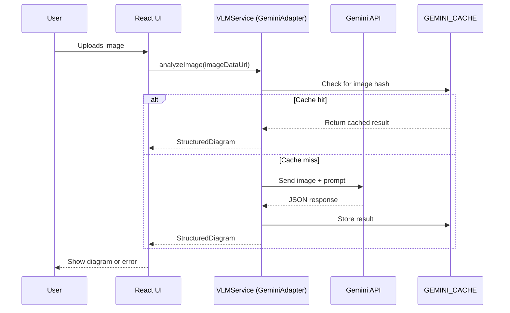

# Sketcher App

## Folder Structure

- `src/components/` — Reusable UI components (e.g., Header, Footer)
- `src/layouts/` — Layout templates (e.g., MainLayout)
- `src/pages/` — Page components (e.g., Home, About)
- `src/services/` — API and data services
- `src/utils/` — Utility functions
- `src/assets/` — Static assets (images, etc.)

## Base Setup
- React 18 + TypeScript (Vite)
- Bootstrap 5 for UI and layout
- React Router for SPA navigation

## Running the App
```sh
cd app
npm install
npm run dev
```

Open http://localhost:5173 in your browser.

# React + TypeScript + Vite

This template provides a minimal setup to get React working in Vite with HMR and some ESLint rules.

Currently, two official plugins are available:

- [@vitejs/plugin-react](https://github.com/vitejs/vite-plugin-react/blob/main/packages/plugin-react) uses [Babel](https://babeljs.io/) for Fast Refresh
- [@vitejs/plugin-react-swc](https://github.com/vitejs/vite-plugin-react/blob/main/packages/plugin-react-swc) uses [SWC](https://swc.rs/) for Fast Refresh

## Expanding the ESLint configuration

If you are developing a production application, we recommend updating the configuration to enable type-aware lint rules:

```js
export default tseslint.config({
  extends: [
    // Remove ...tseslint.configs.recommended and replace with this
    ...tseslint.configs.recommendedTypeChecked,
    // Alternatively, use this for stricter rules
    ...tseslint.configs.strictTypeChecked,
    // Optionally, add this for stylistic rules
    ...tseslint.configs.stylisticTypeChecked,
  ],
  languageOptions: {
    // other options...
    parserOptions: {
      project: ['./tsconfig.node.json', './tsconfig.app.json'],
      tsconfigRootDir: import.meta.dirname,
    },
  },
})
```

You can also install [eslint-plugin-react-x](https://github.com/Rel1cx/eslint-react/tree/main/packages/plugins/eslint-plugin-react-x) and [eslint-plugin-react-dom](https://github.com/Rel1cx/eslint-react/tree/main/packages/plugins/eslint-plugin-react-dom) for React-specific lint rules:

```js
// eslint.config.js
import reactX from 'eslint-plugin-react-x'
import reactDom from 'eslint-plugin-react-dom'

export default tseslint.config({
  plugins: {
    // Add the react-x and react-dom plugins
    'react-x': reactX,
    'react-dom': reactDom,
  },
  rules: {
    // other rules...
    // Enable its recommended typescript rules
    ...reactX.configs['recommended-typescript'].rules,
    ...reactDom.configs.recommended.rules,
  },
})
```

## VLM/LLM Integration: Testing & Documentation

### Overview
This project integrates a Vision-Language Model (VLM/LLM, e.g., Gemini) to analyze uploaded whiteboard images and extract structured diagram data. The flow includes:
- User uploads an image
- The image is sent to the VLM/LLM service
- The model returns a structured JSON diagram (shapes, relationships, styles)
- Results are cached by image hash to optimize performance and reduce API costs

### Sequence Diagram


### Running Integration Tests
- Ensure dependencies are installed: `npm install`
- Run all tests: `npm run test`
- Integration tests are located in `src/services/vlmService.test.ts`
- Tests cover:
  - Valid diagram extraction
  - Caching behavior
  - (Planned) Error handling and cache eviction

### Troubleshooting
- **API Key Issues:** Ensure a valid Gemini API key is set in preferences. Invalid or missing keys will cause authentication errors.
- **Quota/Rate Limits:** If you hit quota or rate limits, wait and try again, or check your API usage.
- **Network Errors:** Check your internet connection and API endpoint configuration.
- **Malformed Responses:** If the model returns invalid JSON, check the prompt version and model output. Use the latest prompt template.
- **Cache Not Working:** Ensure the GEMINI_CACHE is not cleared between requests and that image hashes are consistent.

### Developer Notes
- The VLMService is designed for easy extension (add new adapters for other models).
- Caching is in-memory (LRU, max 50 entries). For production, consider persistent or distributed caching.
- Prompt management supports versioning and A/B testing.
- To add more tests, see `vlmService.test.ts` for examples.
- For real API integration tests, set up environment variables or mock fetch as needed.

### Demo Instructions
1. **Start the app:**
   ```sh
   npm run dev
   ```
   Open [http://localhost:5173](http://localhost:5173) in your browser.
2. **Set Gemini API key:**
   - Open the Preferences (gear icon or menu in the top bar).
   - Enter your Gemini API key and save.
3. **Upload a whiteboard image:**
   - Use the upload area on the home page to select or drag-and-drop a whiteboard photo (JPG/PNG).
   - Use a sample image for best results (hand-drawn diagrams, clear shapes/text).
4. **View extracted diagram:**
   - The app will display the structured diagram JSON below the upload area.
   - If successful, you'll see detected elements and relationships.
   - If there's an error, check the troubleshooting section above.
5. **Check caching:**
   - Upload the same image again.
   - The app should return the result instantly (cache hit, see logs for confirmation).
6. **Review logs:**
   - Open the browser console to see info logs for cache/API hits and errors.

**Note:**
- For best results, use clear, high-contrast whiteboard images.
- If you encounter issues, refer to the troubleshooting section above.
- For further testing, try different images and prompt versions (if supported in preferences).
