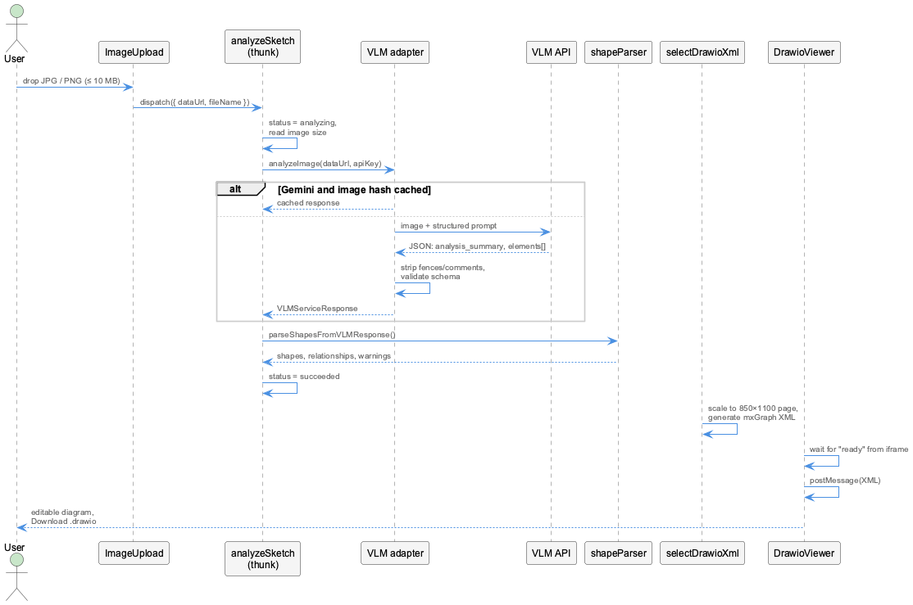

# Analysis Pipeline

What happens between dropping a photo and seeing the diagram.

=== "⚡ Quick (~3 min)"

    ## Five stages

    1. **Upload**: check type and size, read the file as a data URL, measure the image.
    2. **Ask the model**: send the image and a structured prompt to the selected VLM.
    3. **Validate and parse**: clean the answer, check it against the schema, turn
       elements into typed shapes.
    4. **Generate XML**: scale shapes onto an 850 × 1100 draw.io page and emit mxGraph XML.
    5. **Show**: hand the XML to the embedded draw.io editor.

    

=== "📚 Deep Dive (full)"

    --8<-- "_tiers/analysis-pipeline.deep.md"
