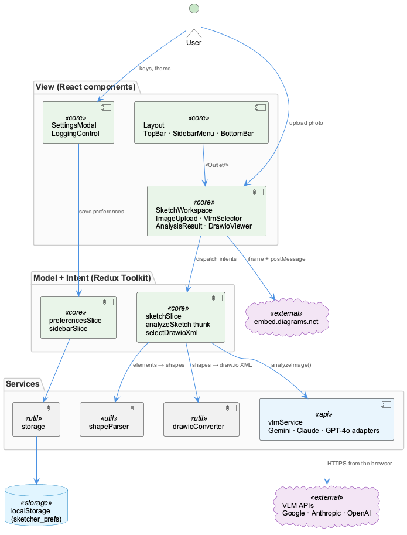

# Architecture

A single-page React app: components show state, Redux holds it, services talk to the
outside world.

=== "⚡ Quick (~3 min)"

    ## The big picture

    

    - **No backend.** The browser calls the model APIs and the draw.io embed directly.
    - **MVI with Redux Toolkit.** Components *dispatch* intents; slices hold the
      *model*; selectors derive what the view shows.
    - **Services are plain TypeScript.** Model adapters, parser and draw.io converter have
      no React in them and are unit-tested with Vitest.

=== "📚 Deep Dive (full)"

    --8<-- "_tiers/architecture.deep.md"
