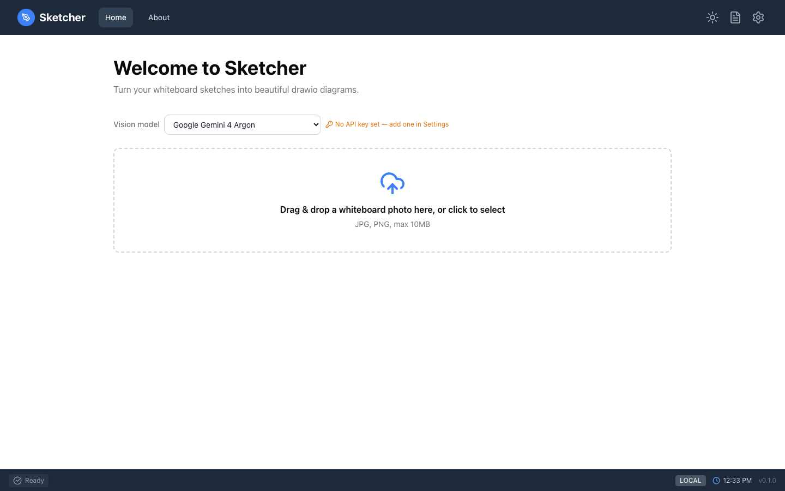

# Getting Started

Install the `sketcher` command, start it and add one API key.

=== "⚡ Quick (~3 min)"

    ## Install and start in four commands

    Needs Node.js 20.19 or newer and the GitHub CLI (`gh`), logged in once with
    `gh auth login`.

    ```sh
    gh release download --repo fwornle/sketcher --pattern 'sketcher-*.tgz'
    npm install -g ./sketcher-*.tgz
    sketcher doctor
    sketcher
    ```

    `sketcher` starts a small local server in the background and opens
    <http://localhost:5180>. Run it again any time to reopen the app; `sketcher stop` stops
    the server and `sketcher update` installs a newer release.

    { .screenshot }

    The amber hint next to **Vision model** means no key is set yet. Click the gear icon,
    open **API Keys**, paste a [Gemini key](vision-models.md#get-an-api-key), and
    **Save Changes**. The hint turns green: you are ready to
    [convert a sketch](sketch-to-diagram.md).

=== "📚 Deep Dive (full)"

    --8<-- "_tiers/getting-started.deep.md"
