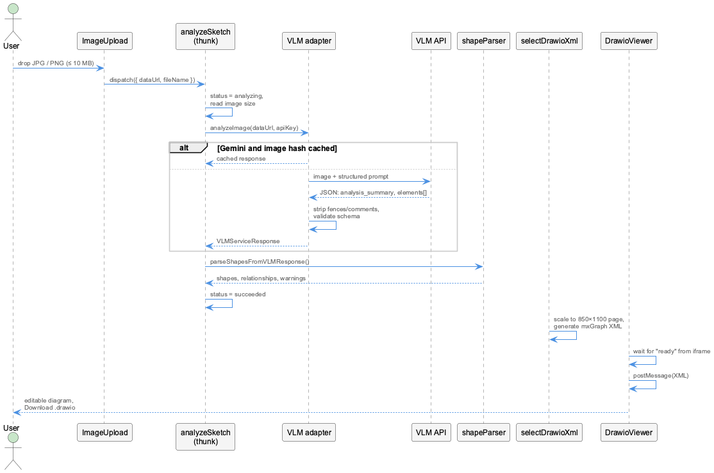
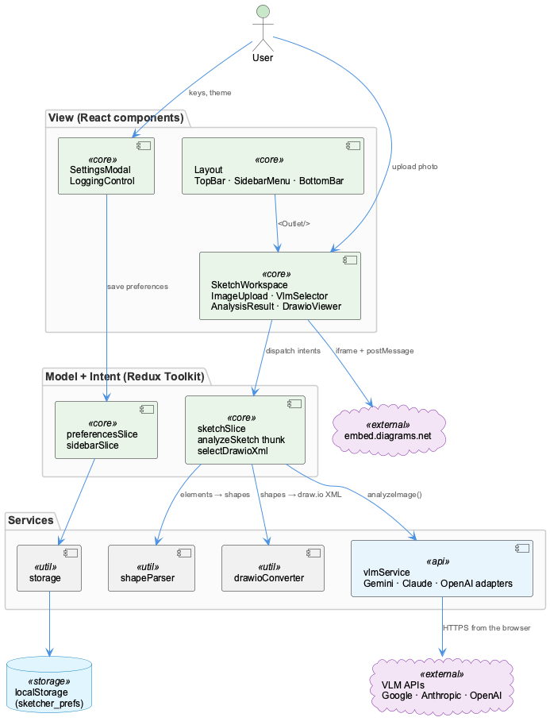
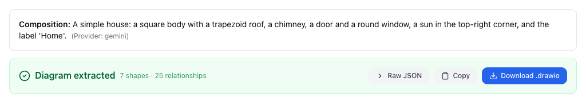
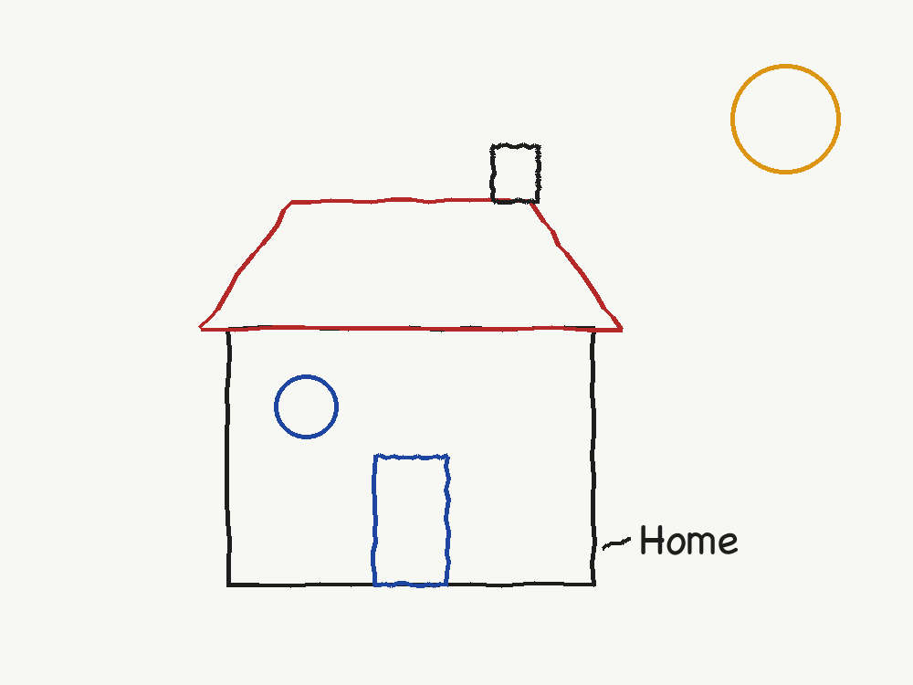
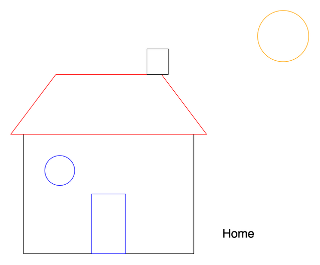
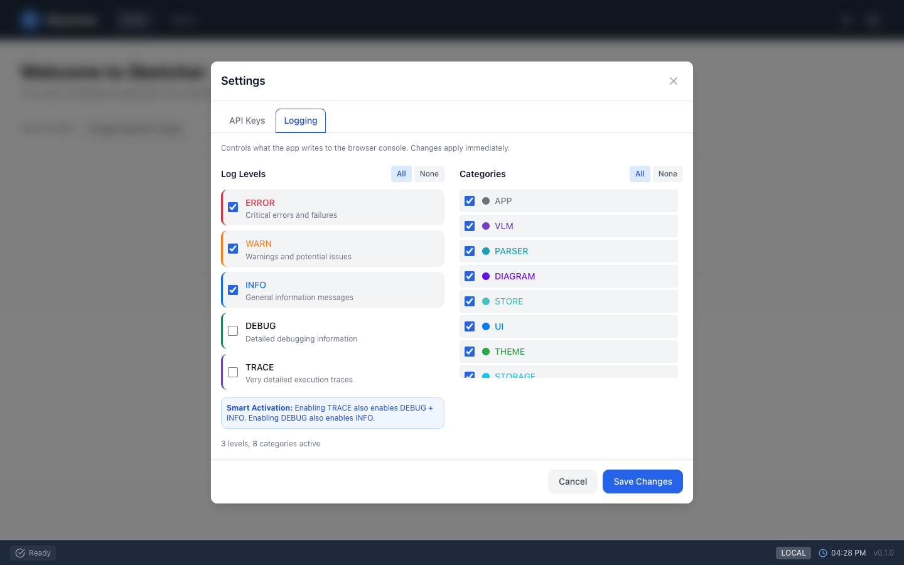

<div class="overview-deck" id="sketcher-how-it-works" role="region" aria-label="How Sketcher works presentation" markdown="1">

<div class="overview-toolbar" hidden>
  <span class="overview-label">Sketcher / how it works</span>
  <span class="overview-counter" role="status" aria-live="polite" aria-atomic="true"></span>
  <button type="button" data-fullscreen>Fullscreen</button>
</div>

<div class="overview-stage" markdown="1">

<section class="overview-slide overview-cover overview-essential" id="slide-1" aria-labelledby="hw-title" markdown="1">
<div class="overview-copy" markdown="1">

<p class="overview-kicker">Under the hood</p>

# From photo to diagram in five stages {#hw-title}

1. **Upload**: check the file, read it, measure the image.
2. **Ask the model**: the image, a detailed prompt and the answer's JSON schema.
3. **Validate and parse**: turn the answer into typed shapes.
4. **Generate draw.io XML**: place the shapes on a page.
5. **Show**: hand the XML to the embedded draw.io editor.

</div>
<figure class="overview-figure" markdown="1">

[](images/sketch-analysis-flow.png){: target="_blank" rel="noopener" title="Open full-size diagram" }

<figcaption>One analysis, from the upload to the editor.</figcaption>
</figure>
<p class="overview-takeaway">Everything runs in the browser; only stage 2 leaves it.</p>
</section>

<section class="overview-slide overview-essential" id="slide-2" aria-labelledby="hw-arch" markdown="1">
<div class="overview-copy" markdown="1">

<p class="overview-kicker">Architecture</p>

## A browser app in three layers {#hw-arch}

- **View**: React components. They show state and turn clicks and drops into intents.
- **Model and intent**: Redux Toolkit. `analyzeSketch` runs the analysis;
  the draw.io XML is derived from the shapes, never stored.
- **Services**: plain TypeScript, tested on their own: one adapter per model,
  the parser, the draw.io converter, storage.

There is **no backend**: the model APIs and the draw.io editor are called from the page.

</div>
<figure class="overview-figure" markdown="1">

[](images/sketcher-architecture.png){: target="_blank" rel="noopener" title="Open full-size diagram" }

<figcaption>Components dispatch, slices hold state, services talk to the outside.</figcaption>
</figure>
<p class="overview-takeaway">A static bundle: nothing to host but the files.</p>
</section>

<section class="overview-slide overview-essential" id="slide-3" aria-labelledby="hw-ask" markdown="1">
<div class="overview-copy" markdown="1">

<p class="overview-kicker">Stage 2</p>

## One prompt, one schema, any model {#hw-ask}

The prompt asks for every shape and text block: its type, pixel bounding box, style,
text and spatial relationships, plus a check of its own geometry.

The **same JSON schema** goes with every request, and each provider constrains the
model to it, so the answer always parses:

| Provider | Structured output |
|---|---|
| Gemini 4 Argon | `responseFormat` with the schema |
| Claude Fable 5.1 / Opus 5.5 | `output_config.format`, plus refusal fallback |
| GPT-6 Astra | strict `json_schema` |

</div>
<figure class="overview-figure" markdown="1">

```json
{
  "analysis_summary": {
    "total_distinct_elements": 7,
    "composition_interpretation": "A simple house ..."
  },
  "elements": [{
    "id": 2, "type": "trapezoid",
    "bounding_box": { "x1": 220, "y1": 220, "x2": 680, "y2": 360 },
    "style_info": { "line_style": "solid", "color": "red", "fill": "none" },
    "text_content": null,
    "relationships": [{ "related_element_id": 1, "relation_type": "above" }]
  }],
  "plausibility_check_notes": "The roof sits on the body."
}
```

<figcaption>A shortened answer: coordinates are pixels in the photo.</figcaption>
</figure>
<p class="overview-takeaway">Everything after the model is the same, whichever model answered.</p>
</section>

<section class="overview-slide" id="slide-4" aria-labelledby="hw-parse" markdown="1">
<div class="overview-copy" markdown="1">

<p class="overview-kicker">Stage 3</p>

## From the answer to typed shapes {#hw-parse}

- **Validate**: an answer without elements fails; a single bad element is repaired
  or skipped, never the whole result.
- **Normalise types**: `square` becomes a rectangle, `line_segment` a line,
  `other_shape` a rectangle.
- **Map styles**: colour names become hex colours draw.io can draw; dashed and dotted
  lines carry over.
- **Flatten relationships**: "left of", "inside", "points to" become one list.

Anything skipped is listed as a warning in the result panel.

</div>
<figure class="overview-figure" markdown="1">

[](images/ui-analysis-result.png){: target="_blank" rel="noopener" title="Open full-size screenshot" }

<figcaption>Shape and relationship counts, the raw answer, and the download.</figcaption>
</figure>
<p class="overview-takeaway">A partly broken answer still gives a diagram, with the gaps named.</p>
</section>

<section class="overview-slide overview-essential" id="slide-5" aria-labelledby="hw-xml" markdown="1">
<div class="overview-copy" markdown="1">

<p class="overview-kicker">Stages 4 and 5</p>

## Placing shapes, then handing over to draw.io {#hw-xml}

- One scale factor fits the photo onto an **850 × 1100** draw.io page, keeping its
  proportions, inside a 50 px margin.
- Triangles are drawn **last**, so roofs and arrow heads stay on top.
- Each type gets its draw.io style; arrows and lines become edges.
- The embedded editor signals *ready*; Sketcher then posts the XML to it.

</div>
<figure class="overview-figure" markdown="1">

| Photo | draw.io |
|---|---|
|  |  |

<figcaption>Relative positions and sizes are kept; the page size is draw.io's.</figcaption>
</figure>
<p class="overview-takeaway">The output is a normal draw.io file: nothing Sketcher-specific in it.</p>
</section>

<section class="overview-slide" id="slide-6" aria-labelledby="hw-next" markdown="1">
<div class="overview-copy" markdown="1">

<p class="overview-kicker">Where it goes next</p>

## Limits today, and how to extend it {#hw-next}

**Not yet:**

- Relationships are parsed but not drawn as connectors.
- Downloads are `.drawio`; export SVG or PNG from draw.io itself.
- Local models (Qwen2.5-VL, Florence-2, CogVLM, LLaVA) are listed but have no adapter.

**Add a model:** write one adapter with `analyzeImage()`, register it, mark it
implemented. Parser, converter and editor need no change.

</div>
<figure class="overview-figure" markdown="1">

[](images/ui-logging-control.png){: target="_blank" rel="noopener" title="Open full-size screenshot" }

<figcaption>Per-category logs (VLM, PARSER, DIAGRAM, …) show each stage at work.</figcaption>
</figure>
<p class="overview-takeaway">Details: <a href="../architecture/">Architecture</a>, <a href="../analysis-pipeline/">Analysis Pipeline</a>, <a href="../development/">Development</a>.</p>
</section>

</div>

<nav class="overview-controls" aria-label="Presentation controls" hidden>
  <button type="button" data-prev>Previous</button>
  <div class="overview-dots" aria-label="Choose a slide"></div>
  <button type="button" data-next>Next</button>
  <span class="overview-help">Arrow keys to navigate / F for fullscreen</span>
</nav>
<p class="overview-message" role="status" aria-live="polite"></p>

</div>
