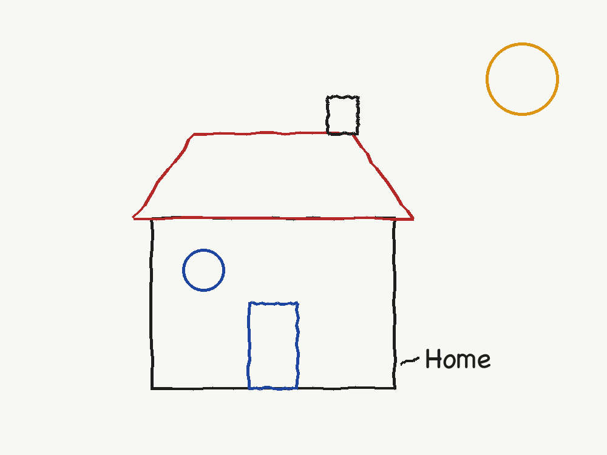
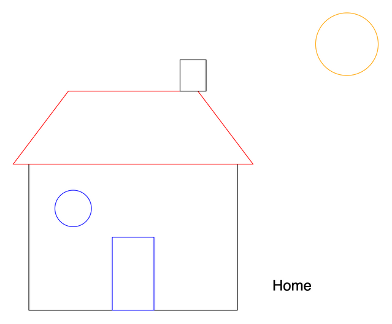

# Sketcher

Photograph a whiteboard sketch, and Sketcher turns it into an editable draw.io diagram.

=== "⚡ Quick (~2 min)"

    ## What it does

    1. You drop a photo of a whiteboard sketch into the app.
    2. A vision-language model (Gemini 4 Argon, Claude Fable 5.1 or GPT-6 Astra) identifies every shape, its
       position, size, colour and text.
    3. Sketcher rebuilds those shapes as a draw.io diagram you can edit in the browser or
       download as a `.drawio` file.

    | Your sketch | The diagram Sketcher builds |
    |---|---|
    |  |  |

    ## Try it

    ```sh
    git clone https://github.com/fwornle/sketcher.git && cd sketcher
    npm install && npm install --prefix app
    npm run dev          # http://localhost:5173
    ```

    Add an API key under **Settings → API Keys**, then drop a photo on the upload area.
    [Getting Started](getting-started.md) walks through it.

=== "📚 Deep Dive (full)"

    --8<-- "_tiers/index.deep.md"
