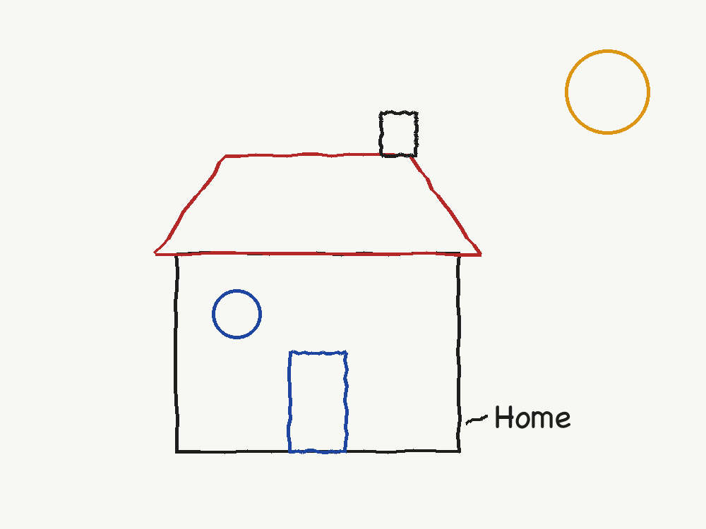
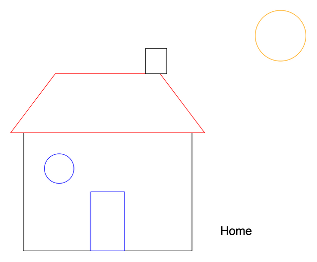
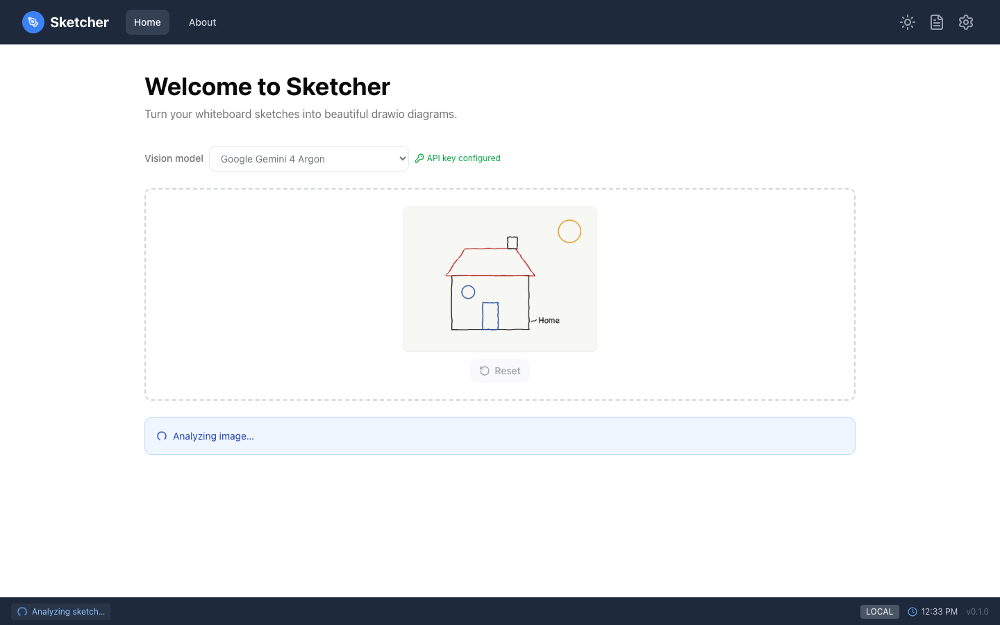
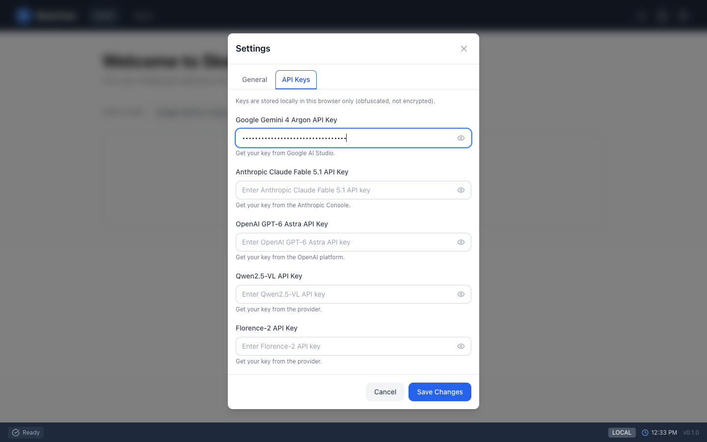
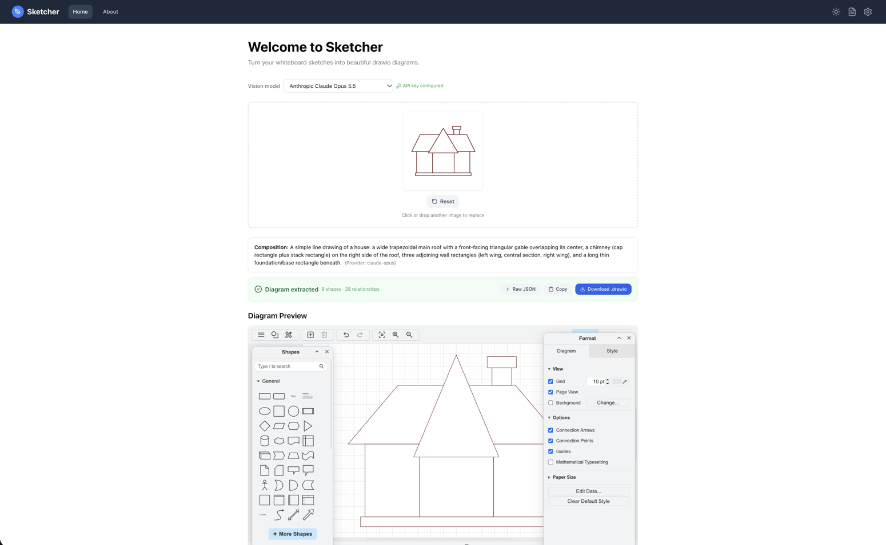
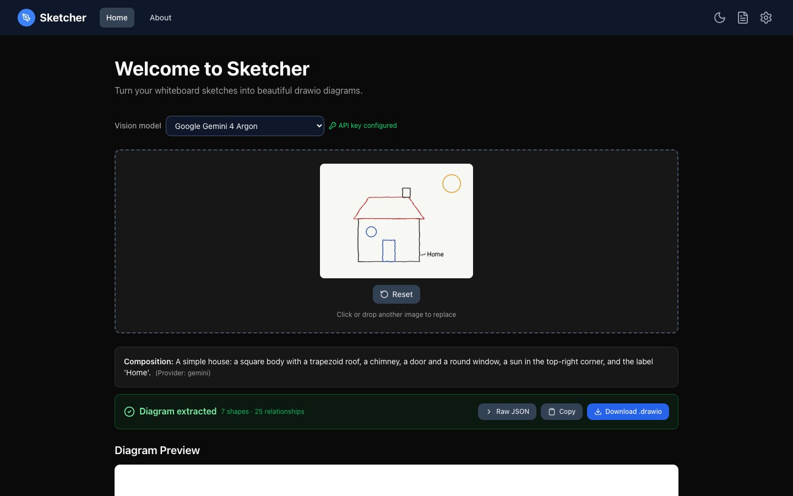
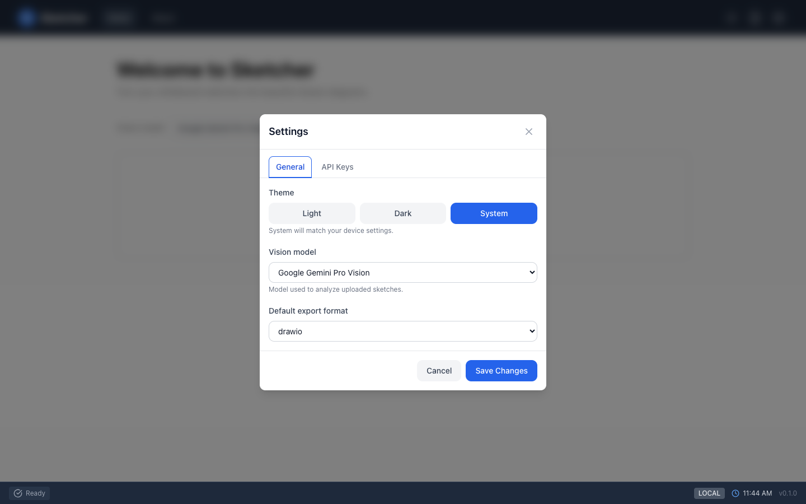
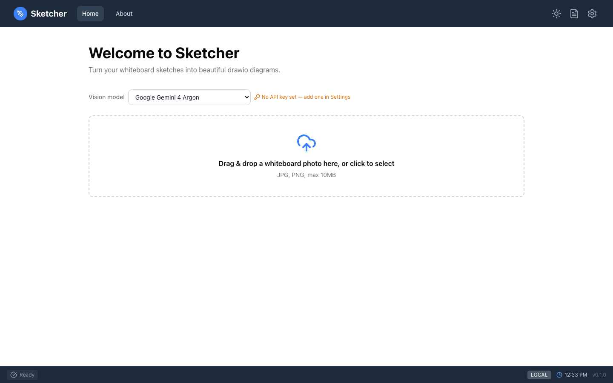

<div class="overview-deck" id="sketcher-overview" role="region" aria-label="Sketcher overview presentation" markdown="1">

<div class="overview-toolbar" hidden>
  <span class="overview-label">Sketcher / overview</span>
  <span class="overview-counter" role="status" aria-live="polite" aria-atomic="true"></span>
  <button type="button" data-fullscreen>Fullscreen</button>
</div>

<div class="overview-stage" markdown="1">

<section class="overview-slide overview-cover overview-essential" id="slide-1" aria-labelledby="so-title" markdown="1">
<div class="overview-copy" markdown="1">

<p class="overview-kicker">Whiteboard to diagram</p>

# Photograph the sketch, edit the diagram {#so-title}

A whiteboard session ends with a photo nobody edits again. Sketcher sends that photo to a
**vision-language model**, which finds every shape, its position, size, colour and text.
Sketcher rebuilds them as a **draw.io diagram** you can edit straight away.

<div class="overview-benefits" markdown="1">

**Snap**  
Drop a JPG or PNG of the board.

**Convert**  
The model reads the shapes; Sketcher draws them.

**Edit**  
A real draw.io editor, and a `.drawio` download.

</div>

</div>
<figure class="overview-figure" markdown="1">

| Your sketch | The diagram Sketcher builds |
|---|---|
|  |  |

<figcaption>Same positions, sizes and colours, now as editable shapes.</figcaption>
</figure>
<p class="overview-takeaway">From a photo to an editable diagram in one step, in your browser.</p>
</section>

<section class="overview-slide overview-essential" id="slide-2" aria-labelledby="so-steps" markdown="1">
<div class="overview-copy" markdown="1">

<p class="overview-kicker">How you use it</p>

## Three steps {#so-steps}

1. **Pick a model** in the *Vision model* list.
2. **Drop a photo** on the upload area: JPG or PNG, up to 10 MB. Analysis starts at once.
3. **Use the result**: a one-line summary of what the sketch shows, the diagram in an
   embedded draw.io editor, and **Download .drawio**.

Drop another photo to replace it, or **Reset** to start over.

</div>
<figure class="overview-figure" markdown="1">

[](images/ui-analyzing.png){: target="_blank" rel="noopener" title="Open full-size screenshot" }

<figcaption>The photo is shown at once; the status bar says what is happening.</figcaption>
</figure>
<p class="overview-takeaway">No account, no install beyond the app: a key for one model is all it needs.</p>
</section>

<section class="overview-slide" id="slide-3" aria-labelledby="so-shapes" markdown="1">
<div class="overview-copy" markdown="1">

<p class="overview-kicker">What it recognises</p>

## Shapes, lines, text and style {#so-shapes}

| On the board | In draw.io |
|---|---|
| Rectangles, squares | rectangles |
| Circles, ellipses | ellipses |
| Triangles, trapezoids, parallelograms, rhombi | the matching draw.io shape |
| Arrows and lines | edges, with or without a head |
| Text | text labels |
| A shape the model cannot classify | a rectangle, so nothing goes missing |

Line colour, solid / dashed / dotted lines and fills carry over. Colour names such as
"dark maroon" become exact colours draw.io can draw.

</div>
<figure class="overview-figure" markdown="1">

[](images/diagram-sample-house.png){: target="_blank" rel="noopener" title="Open full-size image" }

<figcaption>Each shape lands where it was on the photo, scaled to a draw.io page.</figcaption>
</figure>
<p class="overview-takeaway">The model reads the sketch; Sketcher turns its answer into draw.io shapes.</p>
</section>

<section class="overview-slide overview-essential" id="slide-4" aria-labelledby="so-models" markdown="1">
<div class="overview-copy" markdown="1">

<p class="overview-kicker">Your choice of model</p>

## The strongest vision models, side by side {#so-models}

| Model | Provider |
|---|---|
| **Gemini 4 Argon** (default) | Google |
| **Claude Fable 5.1** | Anthropic |
| **Claude Opus 5.5** | Anthropic, same key as Fable |
| **GPT-6 Astra** | OpenAI |

Each is its provider's most capable vision model. They read sketches differently, so
when a result is off, trying another model is a quick second opinion. Qwen2.5-VL,
Florence-2, CogVLM and LLaVA are listed for later.

</div>
<figure class="overview-figure" markdown="1">

[](images/ui-settings-api-keys.png){: target="_blank" rel="noopener" title="Open full-size screenshot" }

<figcaption>One key per provider, entered once under Settings → API Keys.</figcaption>
</figure>
<p class="overview-takeaway">Bring a key for any one provider; switch models from the list at any time.</p>
</section>

<section class="overview-slide" id="slide-5" aria-labelledby="so-result" markdown="1">
<div class="overview-copy" markdown="1">

<p class="overview-kicker">What you get back</p>

## A diagram, and everything the model saw {#so-result}

- **Composition**: the model's one-line reading of the whole sketch.
- **Diagram extracted**: how many shapes and spatial relationships it found.
- **Raw JSON** and **Copy**: every element with its box, style and text.
- **Download .drawio**: opens in draw.io desktop or app.diagrams.net.
- **Diagram Preview**: the real draw.io editor, embedded. Move, restyle, add.

</div>
<figure class="overview-figure" markdown="1">

[](images/ui-diagram-preview.png){: target="_blank" rel="noopener" title="Open full-size screenshot" }

<figcaption>A real run with Claude Opus 5.5: the result panel and the editable diagram.</figcaption>
</figure>
<p class="overview-takeaway">Keep editing in draw.io; the photo's work is done.</p>
</section>

<section class="overview-slide overview-essential" id="slide-6" aria-labelledby="so-reliable" markdown="1">
<div class="overview-copy" markdown="1">

<p class="overview-kicker">Built to hold up</p>

## Answers that always parse {#so-reliable}

- **Guaranteed JSON.** Every request carries the answer's JSON schema, and each
  provider enforces it (structured outputs). No more half-parsed replies.
- **A second Claude when one declines.** If Claude's safety checks decline an image,
  the API re-runs it on a fallback model within the same call.
- **Colours draw.io can draw.** Names like "dark maroon" become exact colours, so
  borders never vanish.
- **Clear errors.** Wrong key, rate limit or quota each get their own message.

</div>
<figure class="overview-figure" markdown="1">

[](images/ui-dark-mode.png){: target="_blank" rel="noopener" title="Open full-size screenshot" }

<figcaption>Light, dark or follow the system.</figcaption>
</figure>
<p class="overview-takeaway">The model may vary; the format of its answer does not.</p>
</section>

<section class="overview-slide" id="slide-7" aria-labelledby="so-privacy" markdown="1">
<div class="overview-copy" markdown="1">

<p class="overview-kicker">Where your data goes</p>

## Your browser, your keys {#so-privacy}

- **No Sketcher server.** The browser sends the photo straight to the provider you
  picked, and to nobody else.
- **Keys stay local.** They are saved in this browser's storage, obfuscated but not
  encrypted. Use keys with spending limits and clear them on shared machines.
- **Logs on demand.** The logging panel picks which levels and categories reach the
  console, for debugging a bad diagram.

</div>
<figure class="overview-figure" markdown="1">

[](images/ui-settings-general.png){: target="_blank" rel="noopener" title="Open full-size screenshot" }

<figcaption>Theme, default model and export format under Settings → General.</figcaption>
</figure>
<p class="overview-takeaway">Only the model provider you choose ever sees the photo.</p>
</section>

<section class="overview-slide overview-essential" id="slide-8" aria-labelledby="so-start" markdown="1">
<div class="overview-copy" markdown="1">

<p class="overview-kicker">Try it</p>

## Running in two minutes {#so-start}

```sh
git clone https://github.com/fwornle/sketcher.git && cd sketcher
npm install && npm install --prefix app
npm run dev          # http://localhost:5173
```

Add a key under **Settings → API Keys**, then drop a photo.

**Not there yet:** connectors between shapes are not drawn from the model's
relationships, and downloads are `.drawio` only.

</div>
<figure class="overview-figure" markdown="1">

[](images/ui-home.png){: target="_blank" rel="noopener" title="Open full-size screenshot" }

<figcaption>The amber hint turns green once the selected model has a key.</figcaption>
</figure>
<p class="overview-takeaway">Next: <a href="../getting-started/">Getting Started</a> and <a href="../sketch-to-diagram/">Sketch to Diagram</a>.</p>
</section>

</div>

<nav class="overview-controls" aria-label="Presentation controls" hidden>
  <button type="button" data-prev>Previous</button>
  <div class="overview-dots" aria-label="Choose a slide"></div>
  <button type="button" data-next>Next</button>
  <span class="overview-help">Arrow keys to navigate / F for fullscreen</span>
</nav>
<p class="overview-message" role="status" aria-live="polite"></p>

</div>
