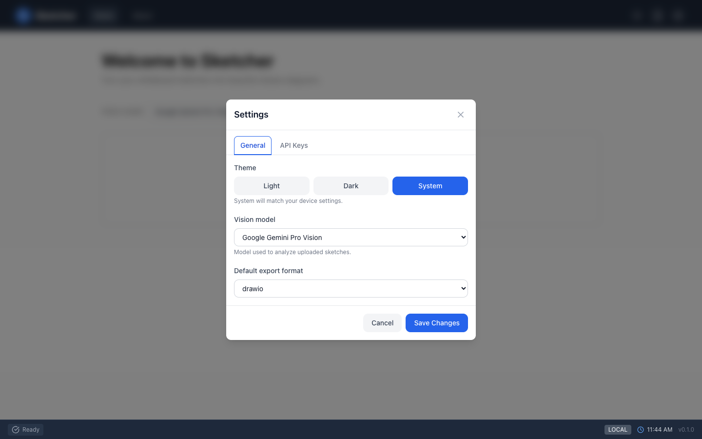

# Settings & Logging

Theme, default model, API keys, and what the app writes to the browser console.

=== "⚡ Quick (~2 min)"

    ## Where things are

    The three icons at the top right:

    | Icon | Opens |
    |---|---|
    | ☀ / ☾ | Switches between light and dark theme |
    | 📄 | **Logging Configuration**: which log levels and categories reach the console |
    | ⚙ | **Settings**: theme, default model, export format, API keys |

    { .screenshot }

    Changes in Settings apply when you click **Save Changes**; **Cancel** discards them.

=== "📚 Deep Dive (full)"

    --8<-- "_tiers/settings.deep.md"
