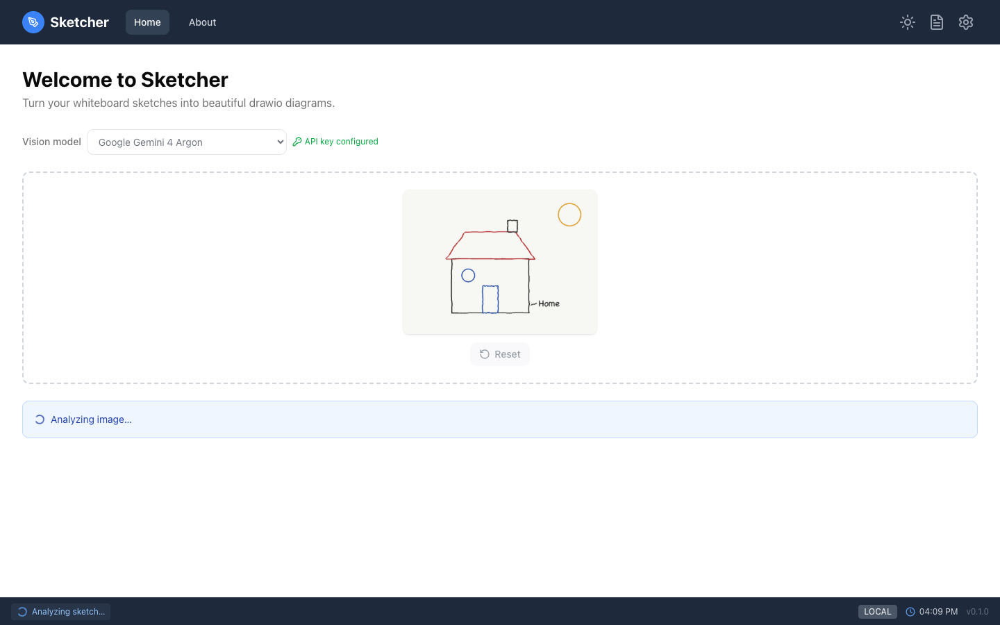
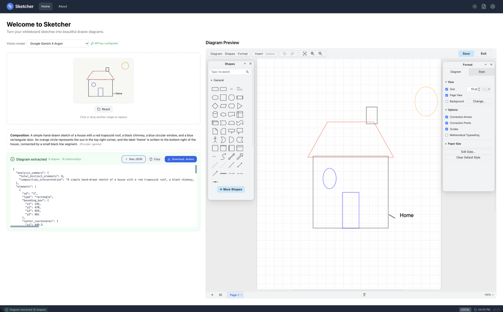

# Sketch to Diagram

Drop a photo, wait a few seconds, edit or download the diagram.

=== "⚡ Quick (~3 min)"

    ## Three steps

    1. **Pick a model** in the **Vision model** list (Gemini is the default).
    2. **Drop a photo** of the whiteboard on the upload area, or click it to choose a file.
       JPG or PNG, up to 10 MB. Analysis starts at once.

        { .screenshot }

    3. **Use the result.** The composition summary says what the model thinks the sketch
       shows; beside it (below it in a narrow window), the draw.io preview holds the
       editable diagram.

        { .screenshot }

    **Download .drawio** saves the diagram for draw.io desktop or app.diagrams.net.
    **Reset** clears the page for the next photo.

=== "📚 Deep Dive (full)"

    --8<-- "_tiers/sketch-to-diagram.deep.md"
